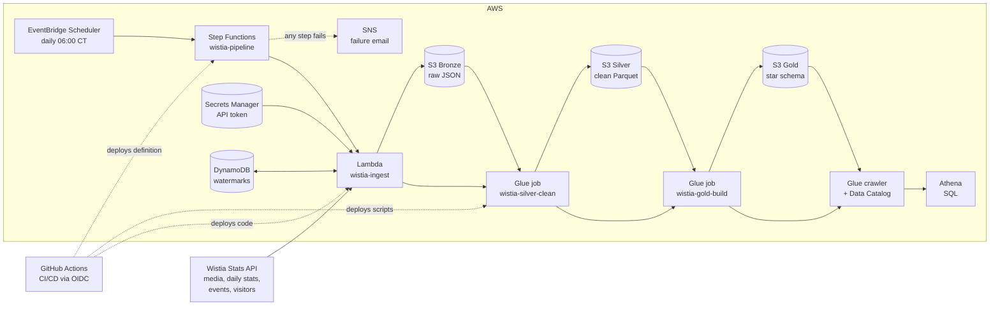
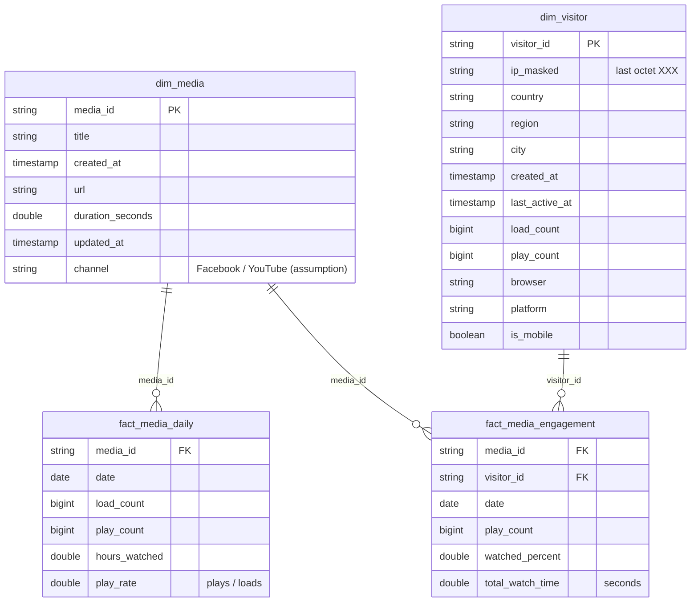

# Wistia Video Analytics Pipeline

A daily, fully automated data pipeline on **AWS** that collects video engagement data from the **Wistia Stats API** for two marketing videos (Facebook and YouTube), cleans it with **PySpark**, models it as a **star schema**, and makes it queryable with **SQL in Amazon Athena**.

| | |
|---|---|
| Cloud | AWS (us-east-1) |
| Ingestion | Python (`requests`) in AWS Lambda, incremental with watermarks |
| Transformation | PySpark on AWS Glue 5.0 (Spark 3.5): Bronze → Silver → Gold |
| Data model | Star schema: `dim_media`, `dim_visitor`, `fact_media_daily`, `fact_media_engagement` |
| Query layer | Glue Data Catalog + Amazon Athena |
| Orchestration | EventBridge Scheduler (daily 6:00 AM Central) → Step Functions; SNS email on failure |
| CI/CD | GitHub Actions with AWS OIDC (no stored keys) |

---

## Architecture



**Daily flow:** the scheduler starts the state machine → Lambda pulls only **new** data from the API into Bronze → Glue cleans it into Silver → Glue builds the Gold star schema and runs reconciliation checks → the crawler refreshes the Athena tables. If any step fails, an email alert is sent.

---

## Repository layout

```
.github/workflows/ci-cd.yml        CI (checks) + CD (deploy to AWS) on push to main
ingestion/wistia_client.py         Lambda: API → S3 Bronze (pagination, retries, watermarks)
transform/silver_clean.py          Glue job: Bronze → Silver (types, dedupe, privacy)
transform/gold_build.py            Glue job: Silver → Gold (star schema + reconciliation checks)
transform/explore_bronze.py        Exploration notebook-style script used during development
orchestration/state_machine.json   Step Functions definition (with failure alert)
iam/                               OIDC trust + deploy policy for GitHub Actions
sql/athena_queries.sql             Business and data-quality queries
docs/                              Design document, runbook, demo script
requirements.txt                   Python packages for local development
```

---

## Data model (Gold)



| Table | Grain | Rows (2026-10-08) |
|---|---|---|
| `dim_media` (SCD1) | one video | 2 |
| `dim_visitor` (SCD1) | one visitor who played our videos | 1,158 |
| `fact_media_daily` | video × day | 1,490 |
| `fact_media_engagement` | video × visitor × day | 1,170 |

Two fact tables because **loads** (needed for play rate) exist only per video per day, while **plays and watched %** exist per visitor.

---

## Results (as of 2026-10-08)

| Channel | Loads | Plays | Play rate | Viewers | Avg watched | Hours watched |
|---|---|---|---|---|---|---|
| YouTube | 915 | 320 | **35.0%** | 280 | **25.8%** | **51.2** |
| Facebook | 118,459 | 944 | **0.8%** | 880 | **14.1%** | 35.8 |

- Facebook reaches ~130× more screens but < 1% of viewers press play, and they watch ~14% of the video (typical autoplay-in-feed behaviour).
- YouTube reaches few people, but 1 in 3 watch, and they watch ~26% → **more total watch time with one third of the plays**.
- **Reconciliation:** average watched % matches Wistia's own dashboard engagement (25.6% / 14.4%); daily plays match lifetime plays within < 3% (daily stats end at the last complete day).

---

## How to run

**Automatic:** nothing to do. The pipeline runs every day at 6:00 AM Central. Check Step Functions → `wistia-pipeline` → Executions.

**Manual run:** Step Functions → `wistia-pipeline` → **Start execution** (input `{}`).

**Query:** Athena → workgroup `wistia-workgroup` → database `wistia_gold` → run queries from `sql/athena_queries.sql`.

**Develop locally** (Windows, Python 3.11, Java 11):
```
python -m venv .venv
.venv\Scripts\activate
pip install -r requirements.txt
aws s3 sync s3://wistia-data-222238779166/bronze/ data\bronze\
python transform\silver_clean.py
python transform\gold_build.py
```

**Deploy a change:** commit and push to `main`. GitHub Actions checks the code, then updates the Lambda, the Glue scripts and the state machine.

---

## Documentation

- [Design document](docs/design_doc.md): requirements mapping, decisions, assumptions, trade-offs, data quality
- [Runbook](docs/runbook.md): every build step and command, troubleshooting, operations, teardown
- [Demo script](docs/demo_script.md): walkthrough for the demo video
